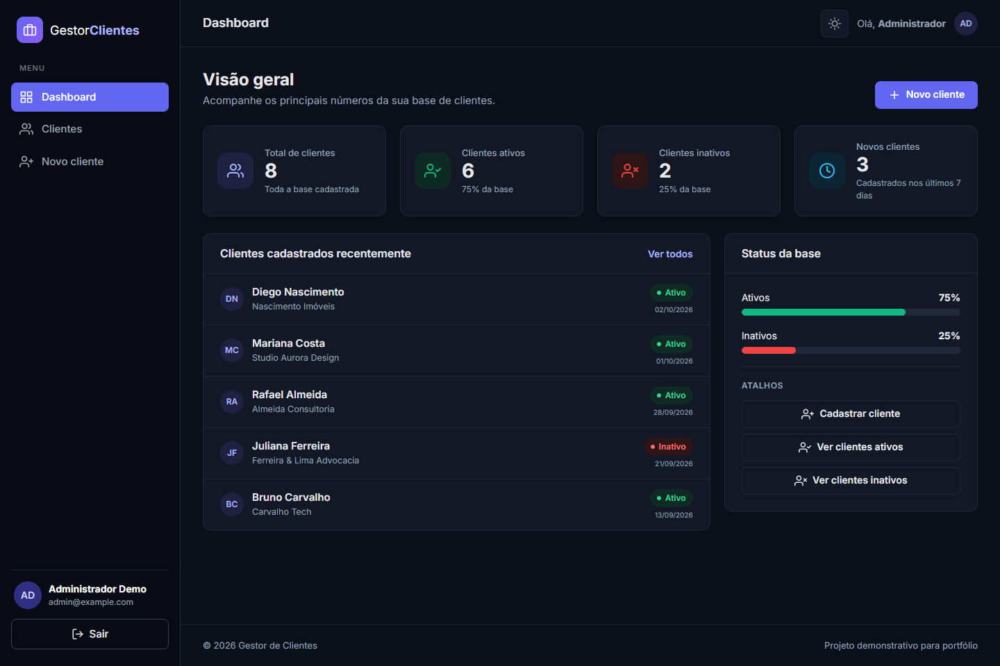
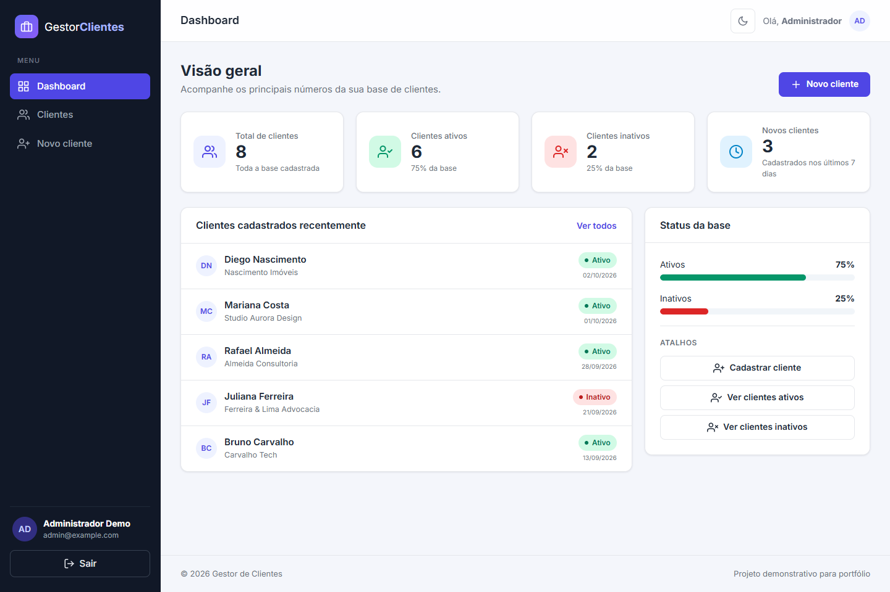
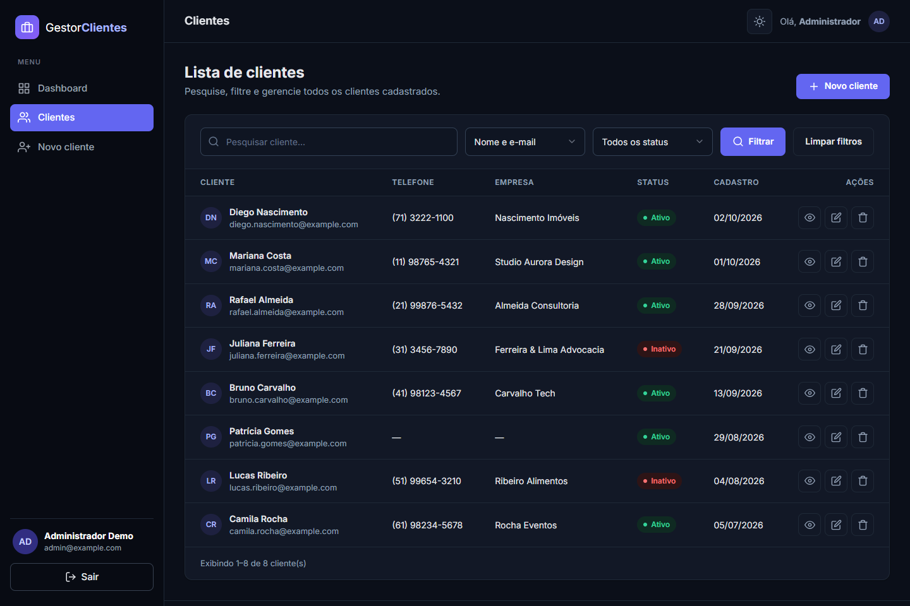
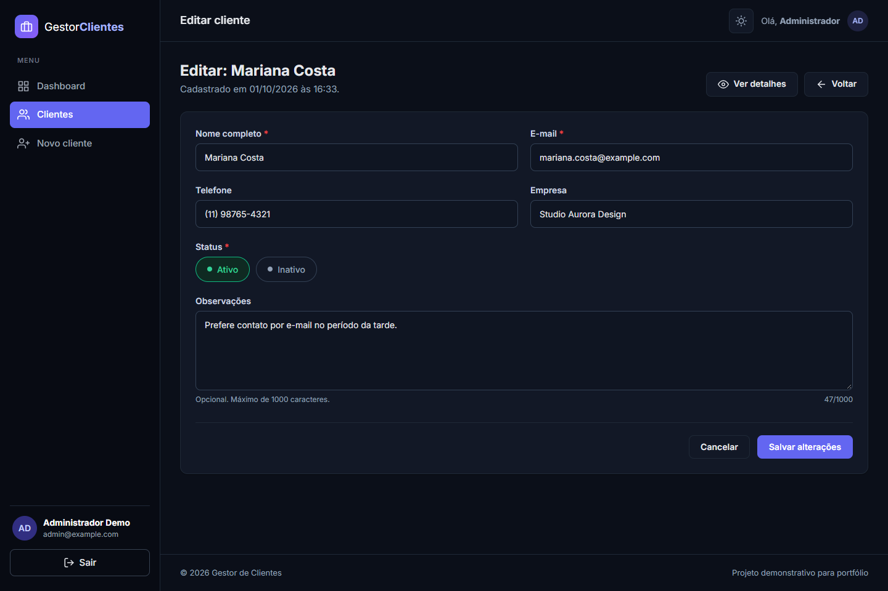
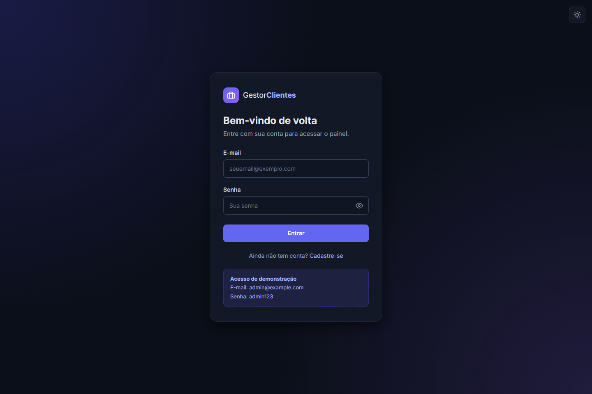
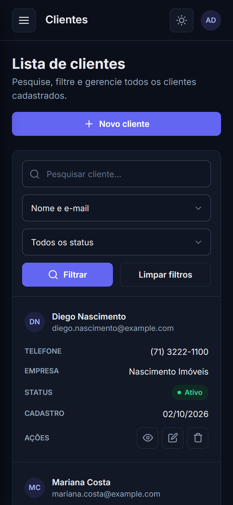

# 📇 Sistema de Gestão de Clientes


Sistema web para cadastro e gerenciamento de clientes, desenvolvido em **PHP puro** (sem frameworks) com **MySQL/MariaDB**. Inclui autenticação de usuários, dashboard com indicadores, CRUD completo, pesquisa e filtros.

> ⚠️ **Projeto pessoal e demonstrativo**, criado para o meu portfólio de freelancer. Todos os dados de exemplo são fictícios.



---

## 📌 Sobre o projeto

O objetivo é mostrar, na prática, a construção de um sistema administrativo completo sem frameworks: código organizado, autenticação com sessões, boas práticas de segurança, banco de dados relacional e uma interface moderna e responsiva.

## ✨ Funcionalidades

### 🔐 Autenticação
- Login e cadastro de usuários
- Logout seguro (POST + token CSRF)
- Senhas criptografadas com `password_hash()` e verificadas com `password_verify()`
- Sessões PHP com novo ID gerado no login e expiração após 30 minutos sem uso
- Páginas privadas protegidas: quem não está logado é levado para a tela de login
- Cada usuário tem a própria carteira de clientes (dados isolados por conta)

### 📊 Dashboard
- Total de clientes
- Clientes ativos e inativos (com percentual)
- Clientes cadastrados nos últimos 7 dias
- Lista dos últimos clientes cadastrados e atalhos rápidos

### 👥 Clientes (CRUD)
- Cadastrar, listar, visualizar, editar e excluir
- Campos: nome, e-mail, telefone, empresa, status, observações e datas de cadastro/atualização
- Janela de confirmação antes de excluir
- Máscara de telefone e contador de caracteres

### 🔎 Pesquisa e filtros
- Pesquisa por nome, por e-mail ou pelos dois
- Filtro por status (ativo/inativo)
- Botão para limpar filtros
- Paginação que mantém os filtros aplicados

### 🎨 Interface
- Layout moderno com menu lateral e cards
- Tema escuro por padrão, com botão para o tema claro (o navegador lembra a escolha)
- Responsivo (no celular, a tabela vira uma lista de cards)
- Mensagens de sucesso e erro
- Ícones SVG embutidos, sem bibliotecas externas

## 🛠️ Tecnologias utilizadas

| Camada | Tecnologia |
|---|---|
| Back-end | PHP 8 (puro, sem frameworks) |
| Banco de dados | MySQL / MariaDB (XAMPP) |
| Acesso a dados | PDO com prepared statements |
| Front-end | HTML5, CSS3 (Flexbox, Grid, variáveis CSS) e JavaScript (ES6+) |
| Ambiente local | XAMPP (Apache + MySQL + phpMyAdmin) |

## 📋 Requisitos

- Windows (ou outro sistema com XAMPP)
- [XAMPP](https://www.apachefriends.org/pt_br/index.html) com PHP 7.4 ou superior (recomendado PHP 8.x)
- Navegador atualizado (Chrome, Edge ou Firefox)
- VS Code (opcional, para editar o código)

## 🚀 Instalação com XAMPP

### 1. Instale o XAMPP
Baixe em https://www.apachefriends.org/pt_br/index.html e instale normalmente (o caminho padrão é `C:\xampp`).

### 2. Coloque o projeto na pasta `htdocs`
Copie a pasta do projeto para:

```
C:\xampp\htdocs\
```

O caminho final deve ficar assim:

```
C:\xampp\htdocs\gestor-clientes-php
```

Se você tem o Git instalado, também pode clonar direto dentro de `C:\xampp\htdocs`:

```bash
cd C:\xampp\htdocs
git clone https://github.com/anthonymartins0312-ops/gestor-clientes-php.git
```

### 3. Abra o XAMPP Control Panel
Menu Iniciar → **XAMPP Control Panel** (ou execute `C:\xampp\xampp-control.exe`).

### 4. Inicie o Apache
Clique em **Start** na linha do **Apache**. O nome do módulo fica verde.

### 5. Inicie o MySQL
Clique em **Start** na linha do **MySQL**. Ele também fica verde.

### 6. Abra o phpMyAdmin
No navegador, acesse:

```
http://localhost/phpmyadmin
```

### 7. Crie ou importe o banco `gestor_clientes`
O arquivo SQL já cria o banco sozinho, então basta importar (passo 8).

> Se preferir criar manualmente: clique em **Novo**, digite `gestor_clientes`, escolha o agrupamento `utf8mb4_unicode_ci` e clique em **Criar**.

### 8. Importe o arquivo `database/gestor_clientes.sql`
1. No phpMyAdmin, clique na aba **Importar** no menu superior.
2. Em **Escolher arquivo**, selecione:
   `C:\xampp\htdocs\gestor-clientes-php\database\gestor_clientes.sql`
3. Clique em **Importar**, no final da página.
4. O banco **gestor_clientes** aparece na lista à esquerda, com as tabelas `usuarios` e `clientes`.

### 9. Acesse o sistema

```
http://localhost/gestor-clientes-php
```

## ⚙️ Configuração do banco

A conexão fica em `config/database.php` e já vem com o padrão do XAMPP:

```php
define('DB_HOST', 'localhost');
define('DB_NAME', 'gestor_clientes');
define('DB_USER', 'root');
define('DB_PASS', '');
```

Se você definiu uma senha para o usuário `root` do MySQL, altere `DB_PASS`.

## 🔑 Usuário de teste

| E-mail | Senha |
|---|---|
| `admin@example.com` | `admin123` |

Você também pode criar sua própria conta pela tela **Cadastre-se**. Uma conta nova começa sem nenhum cliente.

## 📁 Estrutura de pastas

```
gestor-clientes-php/
│
├── index.php               # Redireciona para o login ou para o dashboard
├── login.php               # Tela de login
├── cadastro.php            # Cadastro de usuário
├── logout.php              # Encerra a sessão
├── dashboard.php           # Indicadores e últimos clientes
├── clientes.php            # Listagem, pesquisa, filtros e paginação
├── cliente_novo.php        # Cadastro de cliente
├── cliente_editar.php      # Edição de cliente
├── cliente_ver.php         # Visualização dos dados do cliente
├── cliente_excluir.php     # Exclusão (POST + CSRF)
│
├── config/
│   └── database.php        # Conexão PDO com o MySQL
│
├── includes/
│   ├── auth.php            # Login, logout e proteção das páginas
│   ├── functions.php       # Sessão, CSRF, escape, mensagens e formatação
│   ├── cliente_funcoes.php # Validação e consultas de clientes
│   ├── cliente_form.php    # Formulário reaproveitado (novo/editar)
│   ├── header.php          # Topo + menu lateral das páginas privadas
│   └── footer.php          # Rodapé + janela de confirmação
│
├── assets/
│   ├── css/
│   │   └── style.css       # Estilos, tema claro/escuro e responsividade
│   └── js/
│       ├── script.js       # Menu mobile, máscara, confirmação, alertas e botão de tema
│       └── tema.js         # Aplica o tema salvo antes de a página aparecer
│
├── database/
│   └── gestor_clientes.sql # Banco, tabelas e dados de exemplo
│
├── screenshots/            # Capturas de tela usadas neste README
│
└── README.md
```

## 🔒 Segurança implementada

- **SQL Injection:** todas as consultas com dados do usuário usam *prepared statements* (PDO com prepares nativos).
- **XSS:** todo conteúdo exibido passa por `htmlspecialchars()`.
- **CSRF:** token em todos os formulários POST (login, cadastro, clientes, exclusão e logout).
- **Senhas:** `password_hash()` / `password_verify()`, com o hash atualizado automaticamente no login quando o PHP muda o algoritmo padrão.
- **Sessão:** cookies `HttpOnly` e `SameSite=Lax`, `session_regenerate_id()` no login e expiração por inatividade.
- **Isolamento de dados:** todas as consultas filtram pelo usuário logado; não é possível ver, editar ou excluir clientes de outra conta, nem alterando o ID na URL.
- **Validação no servidor:** tamanho dos campos, formato de e-mail e telefone, status permitido e e-mail único.
- **Sanitização:** remoção de tags HTML e espaços extras nas entradas.
- **Exclusão** somente via POST (abrir um link nunca apaga dados).

## 🖼️ Screenshots

| Dashboard (tema escuro) | Dashboard (tema claro) |
|---|---|
|  |  |

| Lista de clientes | Edição de cliente |
|---|---|
|  |  |

| Login | Celular |
|---|---|
|  |  |

## 🧩 Melhorias futuras

- [ ] Níveis de permissão (admin/colaborador) e compartilhamento de clientes entre membros de uma equipe
- [ ] Exportar a lista de clientes para CSV/Excel e PDF
- [ ] Ordenar a tabela clicando nas colunas
- [ ] Histórico de interações por cliente (ligações, reuniões, propostas)
- [ ] Recuperação de senha por e-mail
- [ ] Limite de tentativas de login (proteção contra força bruta)
- [ ] Gráficos no dashboard (ex.: novos clientes por mês)
- [ ] Upload de foto/logo do cliente
- [ ] API REST para integração com outros sistemas
- [ ] Testes automatizados (PHPUnit) e arquitetura MVC

## ❓ Problemas comuns

| Problema | Solução |
|---|---|
| Apache não inicia | A porta 80 pode estar ocupada (Skype, IIS). Em **Config → Apache (httpd.conf)**, troque `Listen 80` por `Listen 8080` e acesse `http://localhost:8080/gestor-clientes-php`. |
| MySQL não inicia | A porta 3306 pode estar sendo usada por outro MySQL instalado. Pare esse outro serviço e tente de novo. |
| "Erro ao conectar ao banco de dados" | Confira se o MySQL está verde no XAMPP e se o banco `gestor_clientes` foi importado. |
| Página não encontrada (404) | Confira se a pasta está em `C:\xampp\htdocs\gestor-clientes-php`. |

## 👨‍💻 Autor

Desenvolvido por **Anthony Neri Martins** como projeto pessoal de portfólio.

## 📄 Direitos autorais

© 2026 Anthony Neri Martins. **Todos os direitos reservados.**

O código está público apenas para **visualização**, como portfólio. Você pode baixar e executar o projeto localmente para avaliar o meu trabalho, mas não é permitido copiar, modificar, redistribuir ou usar este código, no todo ou em parte, sem autorização por escrito. Veja o arquivo [LICENSE](LICENSE).
